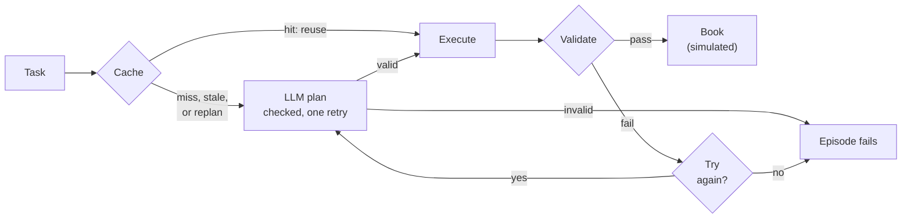

# About this experiment

**Question.** When an LLM travel agent has already produced a plan that worked, can that plan be
cached and re-executed on a *changed* task, cutting LLM cost without losing task success? And when
the cached plan fails, when is it worth paying for a fresh LLM plan?

The benchmark compares **full LLM re-planning** on every task against **plan-cache reuse**, with and
without a **budget-aware** fallback, across controlled task perturbations.

<!-- RUN_CARD -->

## How one episode works

**Try again?** A failed LLM plan gets one repair under every policy. A failed *reuse* is re-planned only under
`budget_aware`. `replan` never looks in the cache, and `budget_aware` can skip a cached plan that often fails.

Stage names match the Live DAG tab. Under `budget_aware`, a first plan, a repair or a re-plan needs enough token
budget; otherwise the episode ends (see Policies below).

1. **Plan.** The LLM receives the task, the tools with their result fields, and a short example of the plan language.
   It returns a plan: a DAG of MCP tool calls (flights, hotels, ferries, geocoding, weather, experiences), JMESPath
   selections and whitelisted arithmetic. A plan is code, not prose, so it can be re-run without the model.
   Before any tool runs, a check rejects malformed plans and results the model invented; the LLM gets one retry. A
   repair also shows the LLM its failed plan and the violations.
2. **Execute.** A model-free executor runs the DAG level by level (independent tool calls run
   concurrently). This step never calls an LLM. A step that fails counts as a failed validation.
3. **Validate.** An independent, deterministic validator checks routes, dates, ferry legs for island
   destinations, every constraint, and the budget. It **recomputes the total cost itself** and flags
   any mismatch with the plan's own arithmetic.
4. **Commit.** Only a passing itinerary triggers side effects (booking, calendar event, email). They
   are simulated and written to `logs/simulated_actions.jsonl`; nothing is booked or sent.
5. **Cache.** Under `cache` and `budget_aware`, a validated LLM plan is stored as a template: literal task values (dates, cities,
   travellers, email) are replaced by references to the task, so the same plan can run on a new task.

## Why reuse can fail (by design)

| Hazard | Example | Caught by |
|---|---|---|
| **Structure change** | Plan for a city, task now an island that needs ferry legs | Cache compatibility check: `stale`, re-plan |
| **New constraint** | Task adds `refundable_only`; plan never filters on it | Compatibility check: `stale` |
| **Missing constraint** | Plan filters on `max_stops`; new task has none | Compatibility check: `stale` |
| **Stale derived value** | Plan hard-coded a hotel cap of 50% of the *old* budget, or `rooms = 1` for one traveller | Validator: `over_budget` / `total_mismatch` |
| **Tool schema change** | MCP tool arguments changed since the plan was cached | Fingerprint mismatch: `stale` |

Compatibility is derived from the plan's structure (which `task.constraints.*` it references,
whether it searches ferries), never from what the LLM claims about its own plan.

## Policies

| Policy | Rule | Role |
|---|---|---|
| `replan` | Ask the LLM for a new plan every episode; one repair attempt with the failed plan and the validator's feedback | Baseline: maximum adaptivity, maximum cost |
| `cache` | Reuse a compatible cached plan; call the LLM only on a miss or stale entry; accept the result of a failed reuse | Minimum cost |
| `budget_aware` | Reuse when compatible. If reuse fails validation, re-plan **only if** the remaining token budget covers the expected cost of a re-plan (running average). Skip reuse for entries that keep failing (success rate below 50% after 2+ uses) | The proposed method |

How each policy acts in the same situation:

| Situation | `replan` | `cache` | `budget_aware` |
|---|---|---|---|
| Compatible cached plan exists | Ignores it and calls the LLM | Reuses it (0 tokens) | Reuses it, unless it succeeded under 50% of the time over 2+ uses and a re-plan is affordable |
| Reused plan fails validation | n/a | **Accepts the failure** | **Re-plans if affordable**; otherwise the episode fails |
| No compatible plan (miss or stale) | Calls the LLM | Calls the LLM | Calls the LLM if affordable; otherwise the episode fails |
| New LLM plan fails validation | One repair attempt | One repair attempt | One repair attempt, if affordable |

*Affordable* means the remaining token budget covers the expected cost of a re-plan (a running average
of past re-plans). In short, `replan` always pays, `cache` pays only when it has no compatible plan,
and `budget_aware` also pays to recover from a failed reuse.

## Perturbations

Each policy starts with an empty cache. For every task it runs **P0** (the original, which warms
the cache) and then P1–P5. All perturbations are deterministic for a given seed.

| | Change | What it stresses |
|---|---|---|
| P0 | None | Cold start: every policy must plan once |
| P1 | Both dates shift ±1 day | Cheap reuse: only task values change |
| P2 | Both dates shift ±3 days | Same, larger price drift |
| P3 | Destination swapped for another catalogue city | Can cross city ↔ island, so the plan's structure changes |
| P4 | Budget ±20% | Stale budget-derived values inside a reused plan |
| P5 | One constraint added or tightened (no stops, higher hotel rating, refundable only, an experience, transfer time) | Constraint coverage of the cached plan |

Default protocol: 10 tasks (UK origins to European cities and islands) × 6 variants × 3 policies =
180 episodes, seed 7, a 12,000-token budget per episode. The `tasks_100` dataset gives 1,800 episodes.

## Reading the results

- **Success:** the final itinerary passed the validator. Nothing else counts.
- **Provider errors** (billing, key, rate limit, outage) are not model failures: those episodes are excluded from
  success rates and averages, and their number is shown.
- **Cache status:** `hit` (a compatible template was found), `stale` (a candidate exists but is
  incompatible), `miss` (no candidate), `bypass` (the policy never looks, as with `replan`).
- **Decision path:** what the episode did, e.g. `reuse > fallback_replan` or `degrade_budget`.
- **Tokens / cost:** LLM usage for planning only. Reuse costs zero tokens.
- **Latency:** LLM planning and local execution are measured. Tool time is **modelled** from a one-time, frozen
  calibration of real MCP servers and shown separately, with totals at 0×, 0.5×, 1× and 2× tool time.
- **Cross-task reuse:** the template came from a different base task (same origin or destination).

The tabs: **Live** follows the current run; **Live DAG** shows each
episode as an icon pipeline (reuse skips the LLM, a failed check loops back to it) above the executed step graph; **Results** has
the tables; **Paper plots** has downloadable figures; **Actions** lists simulated bookings,
calendar events and emails; **Episode inspector** shows one episode's plan, output and violations;
**Dataset** selects and edits the tasks for the next run (edits are saved as copies); **Settings** holds
model names and API keys.

## Limitations

- **Simulated tool data by default.** Six deterministic simulators stand in for the travel MCP
  servers, so prices, availability and budgets are synthetic. The run card above shows where each run's
  tool data actually came from. Real servers are used only to calibrate latency: their formats, changing
  data, rate limits and unclear storage terms rule them out for runs (`docs/ARCHITECTURE.md`).
- **Modelled latency** covers normal delays only, not rate limits or outages, and is assumed for experiences
  and weather.
- **The `mock` planner is a heuristic, not an LLM.** Its token counts are estimates (characters ÷ 4)
  and its latency is near zero. Use a real provider for claims about cost or latency.
- **Costs are estimates:** reported tokens times the prices in `config/llm_prices.csv`. DeepSeek uses the peak price, and
  failed calls count as \$0. A model without a listed price shows a dash.
- **Small sample.** 10 tasks by default and one seed per run, so no confidence intervals. Repeat with several
  seeds before drawing strong conclusions.
- **Some failures are genuinely infeasible** (no direct flight exists, or the budget is too low even
  for a fresh plan). They lower every policy equally.
