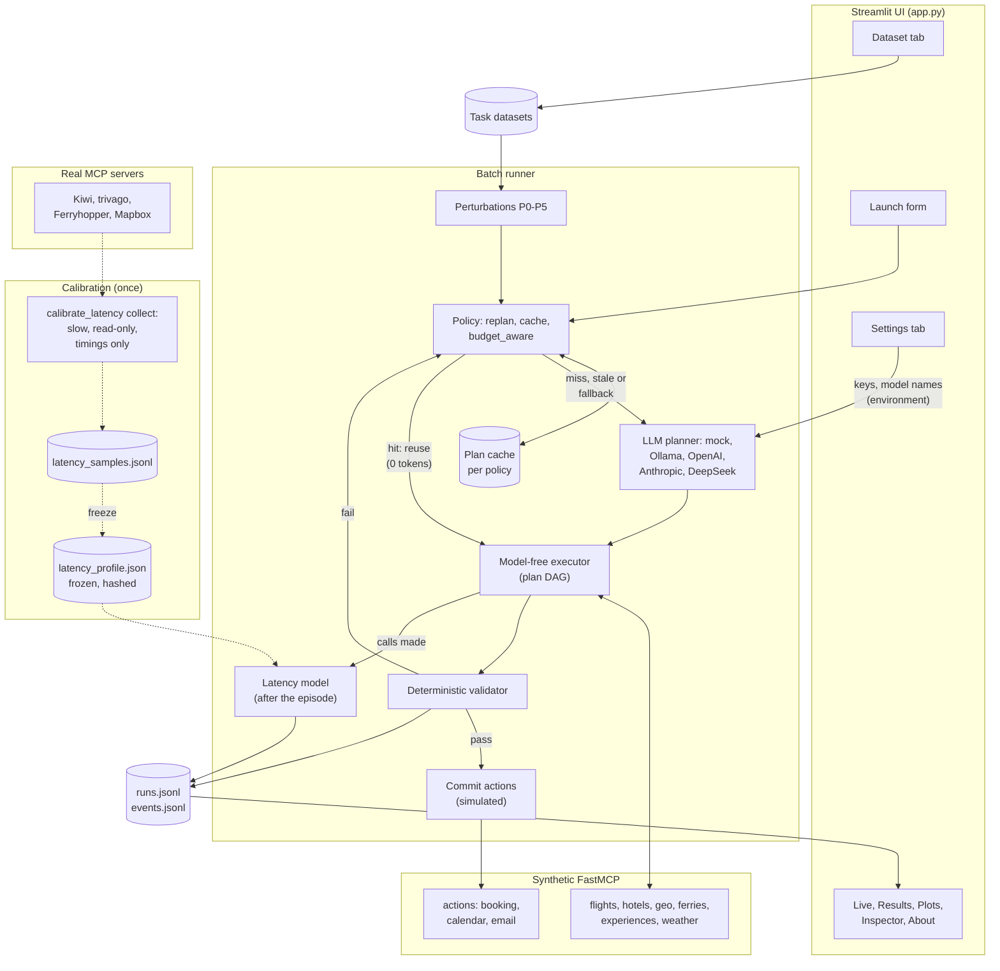
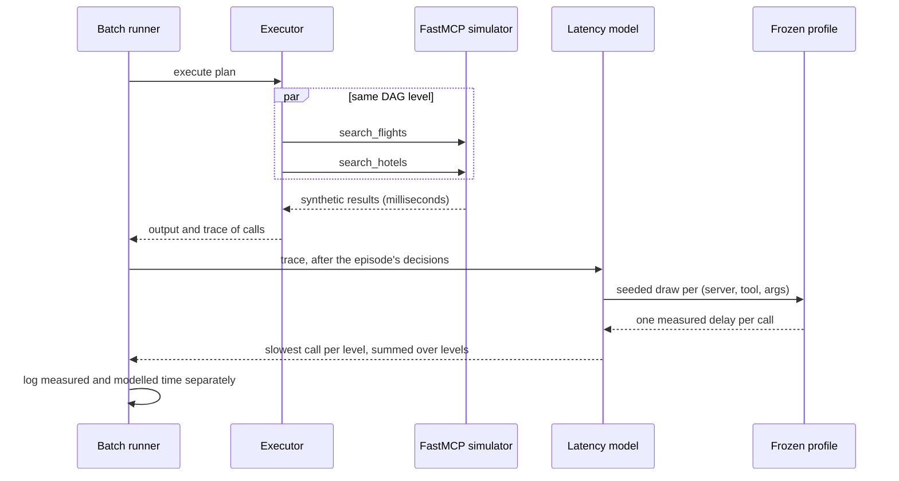

# Architecture and design decisions

Reference for report writing: how the system is built, why tool data is synthetic, how real-server
latency is calibrated, and what the results can and cannot support. The experiment itself (policies,
perturbations, metrics) is described in [ABOUT.md](ABOUT.md).

## 1. System architecture

Solid arrows are part of every benchmark run. Dashed arrows happen once, before the experiment. For a report, use the
exported images: [architecture](img/architecture.png) and [latency sequence](img/latency_sequence.png).



| Component | File | Responsibility |
|---|---|---|
| Planner and LLM clients | `engine/planner.py`, `engine/llm_clients.py` | Prompt, plan parsing, token and cost accounting |
| Executor and validator | `engine/plan_executor.py` | Run the plan DAG without a model; check the itinerary independently |
| Plan cache | `engine/plan_cache.py` | Abstract, match and store plan templates |
| MCP client | `engine/mcp_proxy.py` | Route tool calls, record and replay responses, label their source |
| Synthetic servers | `engine/sim_servers.py`, `engine/local_action_mcp.py` | Deterministic FastMCP stand-ins and simulated actions |
| Runner | `engine/batch_runner.py` | Policies, budgets, logging |
| Calibration | `engine/calibrate_latency.py` | Measure real servers once; freeze the profile |
| Latency model | `engine/latency_model.py` | Add modelled tool time to finished episodes |
| Datasets, settings | `engine/datasets.py`, `engine/settings.py` | Validated dataset copies; keys and model names |
| UI | `app.py`, `dag_view.py` | Display logs, start runs, edit datasets and settings |

## 2. How one call gets its modelled latency



- **Measured:** LLM time (`plan_latency_ms`) and whole-episode wall time (`latency_ms`).
- **Modelled:** tool time (`modelled_tool_ms`). A failed reuse followed by a re-plan is charged for both
  executions.
- **End to end** = measured wall time + modelled tool time. By default no waiting takes place, so runs stay fast.
- **Real-time tool delays** (`--pace`, off by default): each simulated call also waits for its seeded delay, so
  Live DAG shows realistic timing. Waits of one level run together. The wait (`paced_wait_ms`) is excluded from
  `latency_ms` and `exec_latency_ms`, so it is counted only once, as `modelled_tool_ms`. Step timings shown in
  Live and Live DAG include it and say so. Comparing `paced_wait_ms` with `modelled_tool_ms` checks the
  calculation, not whether the profile matches real servers.
- The same call gets the same delay under every policy (common random numbers), so policies are compared
  on equal terms. The run seed and `latency_profile_id` make it reproducible.
- The model runs after all decisions. A test checks that outcomes are identical with and without it.
- Simulated actions (booking, calendar, email) get no modelled delay: they have no real counterpart here.

## 3. Calibration

**Why once, not per run:** network conditions would differ between runs, every launch would need the
internet and contact the providers, and results could not be reproduced. The profile is dated, carries a
hash of its samples, and is rejected if edited. Each run logs the profile it used.

**Method.** `python -m engine.calibrate_latency collect` makes sequential, read-only searches with varied
routes and dates, 2 to 5 seconds apart, and stores **only timings**. Responses are discarded: they are
untrusted text, and storage rights are unclear (section 4). It stops a server at once if throttled and
after 3 errors in a row. `freeze` then writes `config/latency_profile.json`.

**Results.** Profile `a5a280f9061a`, frozen 25 November 2026. Three sessions of 10 calls per tool (14:48, 15:08 and
15:28 UTC, one network location): 150 calls, no errors, no throttling. Session medians agreed within about 18 %.

| Tool | Basis | n | Median (s) | 95th percentile (s) | Range (s) |
|---|---|---|---|---|---|
| Kiwi `search_flights` | Measured | 30 | 2.50 | 3.89 | 1.38-4.15 |
| trivago `search_hotels` | Measured | 30 | 10.94 | 12.13 | 6.60-12.44 |
| Ferryhopper `search_ferries` | Measured | 30 | 0.49 | 0.75 | 0.39-0.86 |
| Mapbox `directions` | Measured | 30 | 1.06 | 3.44 | 0.86-3.88 |
| Mapbox `geocode` | Measured | 30 | 1.14 | 1.51 | 0.85-1.76 |
| Peek `search_experiences` | **Assumed** as Kiwi (searches failed) | 0 | 2.50 | 3.89 | 1.38-4.15 |
| Weather `forecast` | **Assumed** as Mapbox `geocode` (no URL) | 0 | 1.14 | 1.51 | 0.85-1.76 |

All sessions fall within 46 minutes of one afternoon, so daily variation is not captured. With 30 samples the 95th
percentile is approximate. The hotel search dominates, because the other calls run alongside it.

**Check with the `mock` planner** (seed 7, `--source sim`; not evidence about real LLMs):

| Dataset | Mean per episode | `replan` | `cache` | `budget_aware` |
|---|---|---|---|---|
| `sample_tasks` (180 episodes) | Modelled tool time (s) | 12.3 | 12.1 | 13.2 |
| `tasks_100` (1,800 episodes) | Modelled tool time (s) | 13.9 | 11.9 | 16.7 |
| `tasks_100` | Plan executions | 1.19 | 1.02 | 1.43 |
| `tasks_100` | Success | 81 % | 51 % | 83 % |

Recovering from a failed reuse has a real time cost: on `tasks_100`, `budget_aware` runs more executions and so has the
most tool time. Whether it is faster overall depends on LLM planning time, which `mock` does not represent.

**Sensitivity.** The Results tab recomputes end-to-end latency with tool time at 0×, 0.5×, 1× and 2×. Claim a
latency ranking only if it holds across all four.

**What the model leaves out:** rate limiting, outages, timeouts and retries; connection handshakes; contention
between concurrent calls (calibration is sequential); dependence of latency on the query; time-of-day and
seasonal effects beyond the calibration sessions; and the caller's location.

## 4. Why not the real MCP servers

Checked on 25 November 2026 with about 90 slow, read-only requests (excluding the calibration).

| Server | Reachable | Findings |
|---|---|---|
| Kiwi (flights) | Yes | GBP fares through October 2027; at most 15 results per search |
| trivago (hotels) | Yes | About 11 s per search; ratings out of 10; prices as text; responses include instructions aimed at AI assistants |
| Ferryhopper (ferries) | Partly | No sailings found on sampled dates for Barcelona-Ibiza, Naples-Capri or Split-Hvar; prices appear to be in euros |
| Mapbox (geocoding, directions) | Yes, with a token | Documented default of 300 directions requests a minute |
| Peek (experiences) | Lists tools only | Both searches tried failed with a protocol error (`202 Accepted`) |
| Weather | No URL configured | No forecast exists for 2027 dates |

| Reason | Detail |
|---|---|
| **No common contract** | Argument names, date formats, units and response shapes differ from the canonical tools. Renaming fields is not enough; each server needs an adapter |
| **Silent fallback** | With nothing mapped, `live` and `auto` would use the simulator for every call. Both are now refused |
| **Not repeatable** | Prices and availability change between runs, so policies would face different data |
| **Rate limits** | 1,800 episodes would make thousands of searches in bursts. No published limits were found for Kiwi, trivago or Ferryhopper |
| **Storage rights** | Recording would fix repeatability, but permission is unclear (below) |
| **Untrusted text** | Tool responses can contain instructions (prompt injection) |

**Terms on storing results** (as read on 25 November 2026; not legal advice):

| Provider | Status |
|---|---|
| Ferryhopper | Terms prohibit "any copying, distribution, transfer, processing, resale, creation of derivative work"; storing results is not addressed directly. Treated as restricted |
| trivago | MCP documentation is silent; the UK terms page blocked automated reading. Unknown |
| Kiwi | Pages blocked automated reading. Unknown |
| Mapbox | Main terms do not address storing results; the Product Terms PDF could not be opened. Unknown |

Sources: [Ferryhopper terms](https://www.ferryhopper.com/en/terms),
[Ferryhopper MCP](https://ferryhopper.github.io/fh-mcp), [trivago MCP](https://mcp.trivago.com/docs),
[Mapbox terms](https://www.mapbox.com/legal/tos), [Mapbox API limits](https://docs.mapbox.com/api/guides/).

## 5. Data sources and their labels

Every tool call is logged with where its data came from.

| Label | Meaning |
|---|---|
| `sim` | Synthetic FastMCP server (the default) |
| `replay_sim` | Recorded simulator response |
| `replay` | Recorded live response (none exist at present) |
| `live` | Real server (disabled until adapters exist) |
| `sim_fallback` | A live call that fell back to the simulator (disabled with `live`) |

Runs logged before 25 November 2026 may show `replay` for recorded **simulator** data. Treat those as simulated.

## 6. Design decisions

| Decision | Reason | Cost |
|---|---|---|
| Synthetic tool data through FastMCP | Same data for every policy; reproducible, free, no provider load | No claims about real prices or availability |
| Frozen latency profile | Realistic tool time without live calls during runs | Covers normal delays only |
| Latency added after the episode | Cannot influence decisions; runs stay fast | Not a wall-clock measurement |
| Model-free executor | Reuse costs exactly 0 LLM tokens | Plans must be fully declarative |
| Deterministic validator | Success never depends on an LLM's judgement | Checks only encoded rules, not flight or ferry times |
| Built-in datasets locked; edits saved as copies | A run's dataset stays fixed; its content hash is logged | Budgets of edited trips are not recalculated |
| Secrets passed only through the environment | Never on a command line or in logs | Session-only keys must be re-entered |
| No map tab | Adds no evidence about reuse against re-planning; routes are already in text | Less visual for demos |

## 6a. Planner prompt revision (25 November 2026)

Run `20261125-154630-f6c1fa` (`qwen3:4b-instruct`, 3 tasks, 54 episodes) scored 0/54: the model wrote invented flights
and hotels into the output and used no `select` steps. Runs before and after this revision are not comparable.

| Change | Reason |
|---|---|
| Result fields of every tool and one deliberately incomplete example plan | The prompt listed only tool inputs; `mock` knows the fields |
| Invented outputs are rejected when the plan is parsed | Prevents answers that are not based on tool results |
| The repair prompt includes the failed plan | Repair previously saw only the violations |
| Failed and timed-out calls count in planning time | Their 180 s waits were missing from `plan_latency_ms`; their tokens are unknown and logged as 0 |
| Ollama: output capped at 4,096 tokens, thinking off, model loaded before timing (`warm_up` event) | Stops runaway output; removes cold-start time from the first policy |

The longer prompt raises token counts, including the `mock` estimates; `mock` outcomes are unchanged.

## 6b. Provider errors

| Kind | Examples | Handling |
|---|---|---|
| Fatal | No credit, bad key, unknown model, rejected request, missing package | Run stops; episode excluded |
| Transient | Rate limit, HTTP 5xx, dropped connection, hosted timeout | Up to 3 retries (2, 5, 15 s or `Retry-After`); then excluded; 3 lost episodes in a row stop the run |
| Model failure | Invalid plan, failed validation, over-long prompt, local model time limit | Counts as a failed episode |

Retry time is logged (`llm_retries`, `llm_retry_ms`) and left out of `plan_latency_ms` and `latency_ms`. Excluded episodes
are counted in the Results, Paper plots and About tabs. Policies can lose different episodes, so repeat such a run before
comparing them.

## 7. Limitations

- **Small local models.** In trials `qwen3:4b-instruct` still corrupted text (for example `"-than": "mapbox"`), with and
  without Ollama's JSON mode. Such failures are recorded as invalid plans.

- **External validity.** Results concern planning policies over synthetic data. They do not show how agents cope
  with real prices, availability, schema drift or server failures.
- **Synthetic budgets.** The 100-task budgets are the cheapest simulated itinerary plus 15-60 %. Real trips cost more:
  one sampled Barcelona hotel stay was far above its simulated price.
- **Some synthetic ferry routes** (Ibiza, Capri, Hvar) returned no real sailings when checked.
- **Times are not validated,** so a flight and ferry on the same day may not connect.
- **Latency is modelled** and partly assumed (experiences, weather). Latency claims need a real LLM: the `mock`
  planner takes under a millisecond.
- **Token and cost figures** for `mock` are estimates. LLM prices in `engine/llm_clients.py` need checking.

## 8. Reproducing the setup

```bash
python -m engine.batch_runner --provider mock --source sim                       # 10 tasks, 180 episodes
python -m engine.batch_runner --provider ollama --tasks data/tasks_100.json      # 100 tasks, 1,800 episodes
python data/build_tasks_100.py                                                   # regenerate the 100 tasks
python -m engine.calibrate_latency collect --calls 10                            # live; repeat at other times
python -m engine.calibrate_latency freeze --replace                              # new calibration version
```

Report with each result: run ID, provider and model, dataset name and hash, seed, `latency_profile_id`, and the tool
data source. The About tab shows all of these for the selected run.
